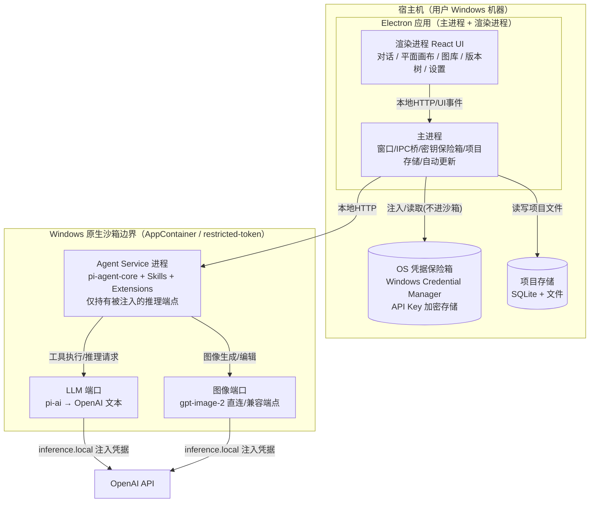

# AICH Design 详细设计 / 技术选型文档（精简版）

> 版本：v0.2　|　基于：PRD v1.3　|　最后更新：2026-08-10
>
> 本文档聚焦**最终架构决策、开发方向与关键技术细节**，去除备选方案、权衡分析与决策过程。Skill 的具体指令实现已移除，仅保留 agent 架构中与 Skill/Extension 对接的接口层与交互规范，供后续独立开发。


---

## 0. 文档关系与范围

| 项目      | 说明                                                                                                                                                                                                                                                                              |
| ------- | ------------------------------------------------------------------------------------------------------------------------------------------------------------------------------------------------------------------------------------------------------------------------------- |
| 上游文档    | `AICH-Design-PRD.md`（v1.3）—— 需求基线、目标、功能清单、里程碑                                                                                                                                                                                                                                   |
| 本文档范围   | 技术选型结论、系统架构、各模块接口契约、工程实现路径                                                                                                                                                                                                                                                      |
| 不覆盖     | 具体 UI 视觉稿、商业定价、法务合规深度审查（仅标注风险）                                                                                                                                                                                                                                                  |
| 关键决策/确认 | ① 自研 React UI（pi monorepo 无 `pi-web-ui`）；② Skill/Extension 底层落 pi-agent-core 工具调用+状态管理原语，并对齐 Anthropic Agent Skills 开放标准（系统提示词仅含 L1 元数据）；③ 双端口 baseURL 可配；④ 取消本地轻量模型兜底；⑤ 里程碑重排（M2 图像 / M3 方案）；⑥ 沙箱改为 Windows 原生隔离（restricted-token / AppContainer），不再依赖 OpenShell / Docker/WSL2 |

---

## 1. 技术选型总览

### 1.1 选型决策表

| #   | 决策项             | **选定**                                            |
| --- | --------------- | ------------------------------------------------- |
| T1  | 内核基座（Agent 运行时） | **pi-agent-core（开源）**                             |
| T2  | LLM 接入抽象        | **pi-ai（统一多 Provider）**                           |
| T3  | 桌面框架            | **Electron**                                      |
| T4  | 渲染进程 UI 框架      | **React + TypeScript**                            |
| T5  | 沙箱隔离            | **Windows 原生隔离（restricted-token / AppContainer）** |
| T6  | 平面方案输出格式        | **SVG**                                           |
| T7  | 图像模型            | **gpt-image-2**                                   |
| T8  | 图像接入端口          | **独立图像端口**                                        |
| T9  | 本地存储            | **SQLite（better-sqlite3）+ 文件**                    |
| T10 | 构建/打包           | **electron-builder**                              |
| T11 | 进程通信            | **本地 HTTP（agent-service ↔ 主进程）**                  |

### 1.2 决策确认结论

| 项                  | 结论                                                                                                    |
| ------------------ | ----------------------------------------------------------------------------------------------------- |
| pi-web-ui 复用       | 改为**自研 React UI**；pi monorepo 公开包仅为 `pi-ai / pi-agent-core / pi-coding-agent / pi-tui / pi-telemetry` |
| Skill/Extension 措辞 | pi-agent-core 暴露**工具调用 + 状态管理**原语；产品设计 Skill/Extension 为产品级封装约定，对齐 Anthropic Agent Skills 开放标准        |
| Skill 实现格式         | 对齐 Anthropic：SKILL.md（frontmatter + 正文）+ 渐进式披露，基础系统提示词仅含 L1 元数据                                       |
| 双端口 baseURL 可配     | LLM 与图像端口均可指向任意 OpenAI 兼容端点                                                                           |
| 本地轻量模型兜底           | 已取消                                                                                                   |
| 进程通信               | Electron IPC（渲染↔主）+ 本地 HTTP（主↔Agent Service）组合                                                        |

---

## 2. 系统总体架构

### 2.1 分层与进程模型

Agent 能力抽成**独立的 Agent Service 进程**，由 Electron 主进程拉起，并置于 **Windows 原生沙箱（AppContainer / restricted-token）** 中运行。渲染进程不直接持有模型密钥、不跑 Agent Loop，UI 通过本地 HTTP 与 Agent Service 通信。



> **凭据不进沙箱**：真实 API Key 存于宿主 `KeyStore`，由本地推理代理（inference proxy）在转发请求时注入；沙箱内 Agent Service 只调用 `https://inference.local`，进程内永不见真实 Key。满足 PRD §6「API Key 本地加密存储、项目数据默认不出本机」。

### 2.2 目录 / 包结构（monorepo）

```
aich-design/
├─ packages/
│  ├─ app/                 # Electron 主进程 + 渲染进程（React + Vite）
│  ├─ agent-service/       # 独立 Node 进程：内嵌 pi-agent-core + 加载 skills/extensions
│  ├─ skills/              # 产品设计 Skill（如 plan-draft）
│  ├─ extensions/          # 产品 Extension（如 image-tools）
│  ├─ shared/              # 跨包契约：TS 类型、IPC 协议、JSON Schema、工具 schema
│  └─ sandbox-launcher/    # Windows 原生沙箱（AppContainer / restricted-token）启动封装
├─ resources/              # 图标、NSIS 脚本、默认配置
├─ scripts/                # 构建、签名、发布
└─ package.json            # npm/pnpm workspaces
```

---

## 3. 内核集成设计：pi-agent-core

### 3.1 引入与合规

- 通过 npm 引入 `@earendil-works/pi-agent-core` 与 `@earendil-works/pi-ai`，**锁定版本**并记录于 `package.json`，MIT 许可合规（保留版权声明）。
- pi monorepo 为 TypeScript + npm workspaces + Bun 编译二进制 + vitest 测试；本产品用 Node 22 运行 agent-service，构建用 esbuild/tsup 打包为单文件 Node 可执行。

### 3.2 Agent Loop 最小闭环（M1）

M1 目标：在 Windows/Electron 中跑通「UI 输入一句话 → Agent Service 调用 LLM → 返回文本」的最小端到端循环。

M1 验收：Electron 主进程成功 spawn agent-service，转发一句「你好」，返回非空文本，耗时与成功率可观测（C-6）。

### 3.3 内核可替换接口（G3）

为「换内核不改业务代码」，在 `shared/` 定义与 pi-agent-core 解耦的运行时接口，agent-service 内部适配：

```ts
export interface AgentRuntimePort {
  run(req: { sessionId: string; messages: Message[]; tools?: ToolDef[] }): Promise<RunResult>;
  loadSkill(skill: SkillDef): void;
  registerExtension(ext: ExtensionDef): void;
}
```

`pi-agent-core` 作为该端口的默认实现；未来可替换为自研 Loop 或其他框架，仅改 adapter。

---

## 4. 能力封装：Skill / Extension 接口层与契约

### 4.1 能力封装接口规范（对齐 Anthropic Agent Skills 开放标准）

**系统提示词 vs Skill 分层（交互规范）**

| 层级                              | 内容                                                                   | 何时进入上下文                          | 成本                      |
| ------------------------------- | -------------------------------------------------------------------- | -------------------------------- | ----------------------- |
| **基础系统提示词（Base System Prompt）** | ① 通用 Agent 行为准则（始终生效）② 所有已装 Skill 的 **L1 元数据**（`name`+`description`） | 始终                               | ~100 tokens/Skill（仅元数据） |
| **Skill 正文（L2）**                | `SKILL.md` 的 Markdown 主体：工作流、约束、示例                                   | 仅当 Skill 被触发（description 命中用户意图） | <5k tokens              |
| **Skill 资源（L3+）**               | `references/`（schema、渲染规范）、`scripts/`（工具执行）                          | 按需                               | 未访问则 0                  |

**Skill 目录约定（Anthropic 格式）**

```
packages/skills/<skill-name>/     # 目录名 kebab-case，与 name 一致
├─ SKILL.md                       # 必需：YAML frontmatter + 正文指令
├─ references/                    # L3：按需读取（schema / 渲染规范 / 示例）
├─ scripts/                       # L3：工具实现，执行后仅输出进上下文
└─ tests/
```

**SKILL.md frontmatter 字段约束（作者接口规范）**

- `name` ≤64 字符、仅小写/数字/连字符、与目录名一致；
- `description` ≤1024 字符、**第三人称**、必须写清「做什么 + 何时用」（Skill 被发现的唯一依据）；
- 可选字段：`allowed_tools`（工具白名单，安全边界）、`license`、`compatibility`、`metadata`。

**Extension**：沿用「注册工具 + 事件钩子」的 bundle 形态；触发描述同样进入基础系统提示词的 L1 元数据；区别在于 Extension 主要注册**工具**而非长篇指令。

### 4.2 Provider 配置：双端口均可指向任意 OpenAI 兼容端点

LLM 端口与图像端口各自独立配置 `baseURL`，可指向官方 OpenAI，也可指向任意 OpenAI 兼容端点（自建网关、合规中转等）。

```yaml
# agent-service 配置（节选）
providers:
  llm:                       # LLM 文本端口（基于 pi-ai / 直接 OpenAI 兼容调用）
    type: openai-compatible
    baseURL: https://api.openai.com/v1     # 可改为任意兼容端点
    apiKeyRef: keystore:openai            # 真实 Key 存于宿主 KeyStore，不进沙箱
    model: gpt-5.5
    timeoutMs: 120000
  image:                     # 图像端口（独立，基于 OpenAI Image API）
    type: openai-compatible
    baseURL: https://api.openai.com/v1     # 独立端点，可与 LLM 不同
    apiKeyRef: keystore:openai
    model: gpt-image-2
    timeoutMs: 180000
```

- **端口隔离**：`llm` 与 `image` 是两个独立 Provider 实例，分别限流、配额、计费、故障隔离。
- **切换零代码**：换模型/换端点 = 改配置，业务代码不动（G3）。

---

## 5. 平面起草能力技术契约（模块 A）

> 本模块为 plan-draft 能力的**接口与数据契约**，具体 SKILL.md 指令正文与 references 资源由后续 Skill 独立开发实现。

### 5.1 数据流

```
自然语言描述 → [LLM + plan-draft L2 正文(按需注入)] → 结构化方案 JSON（中间表示）
            → render_svg_plan(JSON) → SVG 字符串 → 渲染进程画布展示 / 导出
```

### 5.2 中间表示 JSON Schema（PlanStructure）

```json
{
  "$schema": "http://json-schema.org/draft-07/schema#",
  "title": "PlanStructure",
  "type": "object",
  "required": ["bounds", "rooms", "walls"],
  "properties": {
    "bounds": { "type":"object", "properties": {
      "widthM": {"type":"number"}, "heightM": {"type":"number"}
    }},
    "rooms": { "type":"array", "items": {
      "type":"object",
      "required":["id","name","type","x","y","w","h","orientation"],
      "properties": {
        "id":{"type":"string"}, "name":{"type":"string"},
        "type":{"enum":["bedroom","living","kitchen","bath","study","balcony","corridor","other"]},
        "x":{"type":"number"},"y":{"type":"number"},"w":{"type":"number"},"h":{"type":"number"},
        "orientation":{"enum":["N","S","E","W","NE","NW","SE","SW"]},
        "areaM2":{"type":"number"},
        "adjacentTo": {"type":"array","items":{"type":"string"}}
      }
    }},
    "walls": { "type":"array", "items": {
      "type":"object",
      "properties": {
        "id":{"type":"string"},
        "x1":{"type":"number"},"y1":{"type":"number"},"x2":{"type":"number"},"y2":{"type":"number"},
        "thicknessMm":{"type":"number","default":200},
        "hasDoor":{"type":"boolean"},"hasWindow":{"type":"boolean"}
      }
    }},
    "openings": {"type":"array","items":{
      "type":"object",
      "properties":{"kind":{"enum":["door","window"]},"wallId":{"type":"string"},"offsetM":{"type":"number"},"widthM":{"type":"number"}}
    }}
  }
}
```

### 5.3 `render_svg_plan` 工具契约

- **输入**：符合 `PlanStructure` 的 JSON（由 LLM 产出）。
- **输出**：SVG 字符串。
- **渲染规范**：
  - 坐标系：`viewBox="0 0 W H"`，单位 px；比例尺 `scale = 50 px/m`（可在 config 调）。
  - 图层顺序：墙体（深色填充，含门洞/窗洞）→ 房间填充（浅色 + 名称 + 面积）→ 开口（门弧线/窗双线）→ 尺寸标注（轴线 + 数值）→ 指北针。
  - 样式：墙体 `fill:#333`，房间 `fill:#eef`，文字 `font-family:sans-serif`。
- **校验**：渲染前用 JSON Schema 校验 LLM 输出，失败则要求 LLM 修正（A-2 结构化数据模型保证可编辑性）。

### 5.4 对话式修改（A-4）与多方案（A-5）

- 修改流：用户自然语言 → LLM 在会话上下文中对 `PlanStructure` 提出**增量补丁（JSON Patch / 覆盖字段）** → 重渲染 SVG → 新版本入版本树（parentVersionId 指向旧版）。
- 多方案：一次请求让 LLM 产出 2~~3 个独立 `PlanStructure`，渲染为 2~~3 张 SVG 供比选（A-5）。

### 5.5 导出（A-3 / A-7）

- SVG：直接保存工具输出。
- PNG：渲染进程用 `canvas`/`sharp` 栅格化 SVG。
- JSON：保存 `PlanStructure` 源。
- DWG/IFC：P2，预留 `toDxf` 扩展接口，v1 至少 SVG/PNG/JSON。

---

## 6. 图像 Extension 技术契约（模块 B）

### 6.1 Extension 工具契约

| 工具               | 入参（节选）                                                              | 出参                      | 端点                                                  |
| ---------------- | ------------------------------------------------------------------- | ----------------------- | --------------------------------------------------- |
| `image_generate` | `prompt, size?, quality?, outputFormat?, n?`                        | 图像文件 / dataURL / 文件落盘路径 | OpenAI `POST /v1/images/generations`                |
| `image_edit`     | `images[](参考图), prompt, mask?, inputFidelity?, size?, quality?, n?` | 编辑后图像                   | OpenAI `POST /v1/images/edits`（multipart/form-data） |

> v1 采用 **Image API**（generate/edit）作为图像接入端口（对应 T8 端口分离，可独立限流计费）。升级路径：若要支持多轮对话式编辑，可迁移至 Responses API 的 `image_generation` 工具（B-2 增强，仅改 image-tools extension）。

### 6.2 gpt-image-2 适配要点（联调时核对官方最新文档）

- **模型 ID**：`gpt-image-2`（2026-04-21 发布）。
- **不支持透明背景**：`background:transparent` 对 gpt-image-2 会报错；需要透明 PNG 时应路由到 `gpt-image-1.5` 并维护双模型路径。
- **`input_fidelity`**：联调时以 OpenAI 官方 reference 为准，先按「省略该参数」实现，再据实测补充。
- **尺寸约束**：单边为 16 的倍数、最大 3840px、宽高比 < 3:1、像素总数 655,360–8,294,400；size 预设如 `1024x1024 / 1024x1536 / 1536x1024 / 2048x2048`。
- **输出格式**：png / jpeg / webp（jpeg 更快）。
- **edits 入参**：`image` 最多 16 张、png/webp/jpg、单张 <50MB；`mask` 为同尺寸 PNG 带 alpha（alpha=0 重绘）；请求体为 **multipart/form-data** 而非 JSON。
- **计费**：按 token（非按张）——图像输入 $8/1M、输出 $30/1M、文本输入 $5/1M；缓存更便宜、batch 半价。成本监控纳入 C-6 可观测。
- **组织验证**：使用 GPT Image 家族前需在开发者控制台完成 Organization Verification。
- **合规风险**：OpenAI API 存在区域可用性限制。图像端口设计为**可指向任意 OpenAI 兼容端点**（baseURL 可配），以便在国内合规环境下切换至合规兼容服务（具体渠道由商务/法务决定）。

### 6.3 平面 → 表现图联动（B-3）

将 `render_svg_plan` 输出的 SVG 栅格化为 PNG，作为 `image_generate` 的参考图（或 `image_edit` 的 `images[]`），实现「选中平面草案 → 一键出表现图」。

### 6.4 图像版本管理（B-4）

每次生成/编辑落盘到项目 `images/` 目录，元数据（prompt、父版本、参考图、模型、耗时、费用）入 SQLite 版本树，支持回退。

---

## 7. 沙箱设计：Windows 原生隔离（AppContainer / restricted-token）（C-4）

### 7.1 集成架构

v1 沙箱采用 **Windows 原生隔离原语**，不再依赖 OpenShell / Docker / WSL2，零额外安装负担。两套互补机制由 `sandbox-launcher` 按系统能力自动选择：

- **AppContainer**：为 Agent Service 创建低特权 AppContainer，显式声明其可访问的文件/注册表/网络能力；未声明资源默认拒绝。
- **restricted-token（受限令牌）+ 低完整性级别（Low IL）**：以降权令牌（移除特权、设低 IL）启动 Agent Service 子进程，配合 Job Object 限制资源与进程树。

集成方式：

- **进程隔离**：`sandbox-launcher` 以 AppContainer / restricted-token 启动 agent-service 子进程；Agent Service 仅在被授予的资源边界内运行。
- **文件策略**：Agent Service 仅被授予项目目录（工作区）与临时目录的读写 ACL；凭据目录（`%APPDATA%` 下的 KeyStore、`%USERPROFILE%\.ssh` 等）不可见/不可读，生成文件落到用户项目目录（直通宿主，无 bind-mount 概念）。
- **网络策略**：Agent Service 出站仅允许指向本地推理代理 `https://inference.local`；其余出站连接默认拒绝（借助 Windows 防火墙规则或代理白名单）。
- **凭据策略**：真实 OpenAI Key 存于宿主 `KeyStore`（Windows Credential Manager），由本地推理代理（inference proxy）在转发请求时注入；Agent Service 进程**永不见真实 Key**（环境变量/内存均无），与 OpenCode 的代理注入模式一致。

### 7.2 策略示例（声明式，由 sandbox-launcher 翻译为 Windows 原语）

```yaml
# aich sandbox policy（草案，sandbox-launcher 翻译为 AppContainer / restricted-token）
identity:
  mechanism: appcontainer        # appcontainer | restricted-token（按系统能力自动选择）
  integrityLevel: low            # 低完整性级别
  dropPrivileges: true
filesystem:
  - path: %PROJECT_DIR%          # 项目目录：读写
    access: read-write
  - path: %TEMP%                 # 临时：读写
    access: read-write
  - path: %APPDATA%/aich/keystore  # 凭据：拒绝读取（由代理注入）
    access: deny
  - path: /**                    # 其余：拒绝
    access: deny
network:
  egress:
    - host: inference.local      # 仅允许本地推理代理
      allow: true
    - default: deny
capabilities:
  - noNetRaw                     # 禁原始套接字
  - noProcessInject              # 禁注入/提权
```

`sandbox-launcher` 将该声明式策略翻译为具体 Windows 原语：AppContainer 能力清单（caps / file / registry ACL）+ 出站防火墙规则（或代理白名单）+ 受限令牌权限移除 + 低完整性级别。

### 7.3 风险与降级

> 沙箱相关风险与缓解统一见 §12.1 技术风险表（含 AppContainer 配置偏差、Windows 版本降级、网络白名单、推理代理单点等）。

---

## 8. 桌面客户端层详细设计（Electron）

### 8.1 主进程 / 渲染进程职责

| 进程          | 职责                                                                                                                                                                      |
| ----------- | ----------------------------------------------------------------------------------------------------------------------------------------------------------------------- |
| 主进程         | 窗口管理、拉起 Agent Service（经 sandbox-launcher 以 AppContainer / restricted-token 隔离）、本地 HTTP 桥、密钥保险箱（Windows Credential Manager）、项目 SQLite/文件读写、自动更新（electron-updater）、沙箱策略下发 |
| 渲染进程（React） | 对话输入、SVG 平面画布、图库、版本树、设置页；通过主进程转发请求到 Agent Service                                                                                                                       |

### 8.2 UI 设计结论

经核实，pi monorepo 不存在 `pi-web-ui` 包，改为**自研 React 组件库**，核心三个视图：

- `ChatPanel`：对话式输入与消息流。
- `PlanCanvas`：SVG 平面预览 + 缩放/平移 + 选中房间高亮（基于 §5.3 渲染规范）。
- `ImageGallery` + `VersionTree`：图像/方案版本管理与回退。

### 8.3 进程通信：IPC + 本地 HTTP 组合

- 渲染进程 ↔ 主进程：**Electron IPC**（进程内、类型安全、零网络开销）。
- 主进程 ↔ Agent Service：**本地 HTTP（127.0.0.1 + 一次性 token）**（Agent Service 为独立 Node 进程，常跑在沙箱内，HTTP 跨边界最自然、可测试）。
- UI 事件走 IPC 到主进程，主进程作为「安全网关」再通过本地 HTTP 转发给沙箱内 Agent Service；流式输出经 HTTP 回主进程，再经 IPC 推给渲染进程。
- **安全要求**：本地 HTTP 仅监听 `127.0.0.1`，绑定随机端口 + 每次会话一次性 bearer token，防本地提权。

跨两层统一的消息契约（shared 定义，主进程做 IPC↔HTTP 适配）：

```ts
type AgentRequest =
  | { kind:'draftPlan'; sessionId:string; prompt:string; variants?:number }
  | { kind:'editPlan';  sessionId:string; instruction:string; versionId:string }
  | { kind:'genImage';  sessionId:string; prompt:string; refImageId?:string }
  | { kind:'editImage'; sessionId:string; prompt:string; imageId:string; maskId?:string }
  | { kind:'listVersions'; projectId:string };

type AgentResponse =
  | { kind:'plan'; svg:string; structure:PlanStructure; versionId:string }
  | { kind:'image'; imageId:string; url:string; meta:ImageMeta }
  | { kind:'stream'; delta:string }      // 流式文本（思考过程）
  | { kind:'error'; code:string; message:string };
```

---

## 9. 数据模型与本地存储（C-5）

### 9.1 目录布局（每项目）

```
projects/<projectId>/
├─ project.json          # 项目元信息
├─ sessions/<sessionId>.jsonl   # 会话消息流
├─ plans/<versionId>.svg
├─ plans/<versionId>.json       # PlanStructure 源
├─ images/<imageId>.png
└─ meta.db                      # SQLite：版本树/依赖关系/费用
```

### 9.2 SQLite 表（草案）

- `projects(id, name, created_at)`
- `sessions(id, project_id, prompt, model_used, skill_used, created_at)`
- `plan_versions(id, session_id, parent_id, svg_path, structure_path, created_at)`
- `image_versions(id, session_id, parent_id, source, prompt, model, cost_tokens, path, created_at)`

---

## 10. 工程化与 Windows 交付

| 项                | 方案                                                            |
| ---------------- | ------------------------------------------------------------- |
| 包管理              | npm/pnpm workspaces                                           |
| 渲染构建             | Vite（React）                                                   |
| Agent Service 构建 | esbuild/tsup 打包为单文件 Node 可执行                                  |
| 桌面打包             | electron-builder（NSIS 安装包 / AppX）                             |
| 签名               | Windows Authenticode（EV 证书优先，避免 SmartScreen 拦截）               |
| 自动更新             | electron-updater（GitHub Releases / 自有 CDN）                    |
| CI               | GitHub Actions，`windows-latest` 矩阵，构建 + 单元测试 + Playwright E2E |
| 运行时              | Node 22（managed runtime），agent-service 独立版本                   |

---

## 11. 测试策略

| 层级  | 对象                                                                 | 工具              |
| --- | ------------------------------------------------------------------ | --------------- |
| 单元  | 工具适配器（render_svg_plan / image_generate/edit）、JSON Schema 校验、SVG 渲染 | vitest          |
| 集成  | M1 Loop（mock provider 返回文本）、Skill 端到端、Extension 端到端、沙箱边界（尝试越权访问被拒） | vitest + 本地原生沙箱 |
| E2E | Electron 全流程（输入→方案→图→导出）                                           | Playwright      |
| 离线  | 以 mock LLM/Image provider 保证无网可跑通主链路（对应 C-7 配置）                    | 自研 mock         |

---

## 12. 风险与开放问题

### 12.1 技术风险

| 风险                                       | 影响      | 缓解                                                          |
| ---------------------------------------- | ------- | ----------------------------------------------------------- |
| AppContainer 能力/路径配置偏差                   | 隔离失效或过严 | sandbox-launcher 最小权限默认模板 + 启动自检（可读项目目录、可连 inference.local） |
| 部分 Windows 版本对 AppContainer 支持有限         | 沙箱不可用   | 自动降级 restricted-token + Low IL；仍不支持则 fail-closed 拒绝启动       |
| 网络出口白名单配置错误                              | 漏放/泄露   | 默认 deny + 仅放行 inference.local；离线自检，错误即拒绝而非裸跑                |
| 推理代理单点故障                                 | 推理链路中断  | 代理常驻主进程侧，轻量无外部依赖；故障时 fail-closed（拒绝而非裸跑）                    |
| pi-agent-core API 仍在演进                   | 适配成本    | 锁定版本 + 端口抽象（§3.3）                                           |
| gpt-image-2 约束（透明背景/input_fidelity/组织验证） | 功能或成本异常 | 联调核对官方文档；双模型路径备选                                            |
| OpenAI 区域可用性                             | 国内直连受限  | 图像端口可配 OpenAI 兼容端点（合规由商务/法务定）                               |
| gpt-image-2 按 token 计费                   | 成本不可控   | C-6 成本埋点 + 默认 medium 质量 + 批量折扣                              |

### 12.2 遗留开放问题

1. 商业授权与 API 费用分摊模式 —— 商务（非阻塞）。
2. AppContainer 与 restricted-token 的取舍及最低 Windows 版本要求 —— 待技术验证。

---

## 13. 里程碑技术任务拆解

| 阶段                  | 技术任务（具体）                                                                                                                                 |
| ------------------- | ---------------------------------------------------------------------------------------------------------------------------------------- |
| **M1 内核跑通**         | 搭 monorepo；引入 pi-agent-core/pi-ai；实现 AgentRuntimePort adapter；agent-service 最小闭环；Electron 主进程 spawn + 本地 HTTP 桥；mock provider 跑通         |
| **M2 图像 Extension** | image-tools extension；image_generate/image_edit 工具；gpt-image-2 适配（generate/edit、约束核对）；独立图像端口配置（baseURL 可配）；ImageGallery                  |
| **M3 方案起草能力**       | PlanStructure JSON Schema；render_svg_plan 脚本 + SVG 渲染规范；PlanCanvas 预览；对话式修改 + 版本树                                                        |
| **M4 客户端与沙箱**       | Windows 原生沙箱（AppContainer / restricted-token）集成 + sandbox-launcher；声明式策略（翻译为 Windows 原语）；KeyStore 加密 + 推理代理注入；SQLite 项目存储；C-6 可观测 + 成本埋点 |
| **M5 公测**           | Playwright E2E；electron-builder 打包 + 签名；electron-updater；内测指标（激活率/任务完成率/图像成功率）                                                           |

---

## 15. 架构决策记录（ADR-003 ～ ADR-006）

> 状态均为 Proposed（待评审，与文档 v0.2 一致）。本节记录本轮新增架构决策，每条均标注与本文其他章节的关联，避免与 §3/§7/§8/§9 既有设计重复实现。

### ADR-003：会话与上下文生命周期管理

- **Context（补充）**：结构化设计资产（PlanStructure、版本树，§5/§9）是用户成果的**唯一真源，绝不可因压缩而丢失**；只有对话上下文是可压缩的。长设计会话在迭代改方案时还要求状态可稳定恢复（进程重启 / 崩溃）。
- **Decision（扩展）**：
  1. 在 Agent Service 内增设 **Session/Context Manager**，但**复用 §9 的物理存储**（`sessions/<id>.jsonl` + `meta.db`），不另建存储。
  2. **两层记忆**：结构化/持久层（PlanStructure + 版本树）原样落盘，永不被摘要；会话/易失层（消息流）超预算时才摘要。
  3. **Token 预算触发**：保留最近 K 轮原文；当估算上下文 ≥ 模型窗口 70% 时，将更早轮次压缩为紧凑摘要，并**抽取硬约束**（来自 §5 字段与用户显式需求，存入会话元数据）以保护，避免摘要吞掉关键限制。
  4. **Rehydration**：启动/崩溃后加载会话元数据 + 近期消息，并重新挂接当前 PlanStructure/版本（§9）；经 `resumeSession(sessionId)` 恢复。
- **Consequences（补充）**：代价含摘要提示词设计、rehydration 测试（§11），以及明确「哪些算硬约束必须保护」。关联 §9、§3.3、§12 风险。

### ADR-004：统一流式与取消协议

- **Context（补充）**：主进程 ↔ Agent Service 为本地 HTTP（§8.3）；图像生成可耗时数分钟。
- **Decision（扩展）**：
  1. **传输**：流式用 **SSE**（单向、轻量）承载于既有本地 HTTP；**取消**走独立控制请求（携带 `requestId`，如 HTTP 控制通道），不引入 WebSocket，降低适配层复杂度（WebSocket 留作未来双向需求）。
  2. **事件信封**：每个事件含 `{ requestId, sessionId, type: delta|progress|done|error|partial, data }`；`requestId` 由主进程生成、**不可猜测**，并绑定 §8.3 的会话 token，防跨会话取消。
  3. **IPC 中继（§8.3）**：主进程逐帧转发 SSE 至渲染进程，**不缓冲整条流**；渲染进程增量渲染。
  4. **超时分级**：LLM 文本 ~120s；图像生成 ~300s 且发 `progress`；均以 AbortController 可中止。
  5. **部分结果**：对话 delta 增量落 §9；图像生成无「半张图」意义，取消/超时仅持久化请求记录与参数（§6.4 标记 `cancelled`）。**注意**：已开始的图像生成上游仍可能计费，UI 需提示成本风险。
- **Consequences（补充）**：代价为 IPC↔HTTP 流式中继、超时/中止管线与 SSE 封帧。关联 §8.3、§6。

### ADR-005：数据演进与迁移

- **Context（补充）**：核心资产 PlanStructure（§5.2）与 SQLite（§9.2）随版本演进，旧项目须可打开。
- **Decision（扩展）**：
  1. PlanStructure 增加顶层 `"schemaVersion": <int>`；`shared/` 内建迁移注册表，映射 vN→vN+1 变换器，**仅前向、幂等**（探测当前版本，补齐缺失步骤一次）。
  2. SQLite 用 `PRAGMA user_version` + `migrations` 表记录已执行脚本；脚本置于 `shared/migrations`，幂等；**在项目打开时、rehydration（ADR-003）之前**运行，确保数据先升级后使用。
  3. 迁移前备份；**不支持降级**；旧客户端提示「需更新版本」。
  4. 图像元数据（§6.4）随输出格式演进（png/jpeg/webp）一并版本化。
  5. 测试：每历史版本 fixture 往返（§11）。
- **Consequences（补充）**：代价为每次 schema 变更需配套迁移 + fixture 测试。关联 §5.2、§9、ADR-003、§11。

### ADR-006：可恢复任务与降级

- **Context（补充）**：失败边界是经\*\*本地推理代理（§7）\*\*通往上游云 API 的链路，而非本地回环；「本地优先」（§2）需在生产弱网下仍可用。
- **Decision（扩展）**：
  1. 引入**持久化本地任务队列**，存于沙箱可写路径（项目目录 / `%TEMP%`，符合 §7 策略），可跨重启存活。
  2. **幂等键 = ADR-004 的 `requestId`**（或内容哈希），重试时防重复计费 / 重复生成。
  3. 重试：指数退避 + 上限 N，超限进死信；终态失败在 UI 呈现。
  4. **离线降级拆分**：编辑/起草（§5）**完全离线可用**；仅生成/远程调用入队。故改方案永不被网络阻塞。
  5. UI 状态：queued / running / succeeded / failed / cancelled（§6.4 / 版本树）。
  6. **成本护栏**：计费型图像操作的自动重试设上限或需用户确认，防失控成本。
- **Consequences（补充）**：代价为队列持久化、幂等、退避，以及沙箱兼容存储。关联 §7、ADR-004、§6.4。

> **跨 ADR 一致性提示**：持久化应统一边界——§9 负责物理布局，ADR-005 负责版本化，ADR-003/006 负责逻辑管理器；三者共用 §9 存储，**禁止各建一套持久层**。

---

## 16. 附录：术语与引用

- **pi-agent-core**：通用 Agent 运行时（工具调用 + 状态管理），本产品内核基座。
- **pi-ai**：统一多 Provider LLM API（文本），屏蔽 OpenAI/Anthropic/Google 差异。
- **Windows 原生沙箱（AppContainer / restricted-token）**：v1 沙箱选型；用 Windows 安全令牌/低完整性级别/AppContainer 能力清单隔离 Agent Service，无需 Docker/WSL2。
- **gpt-image-2**：OpenAI 图像模型（2026-04-21），Image API 提供 generate/edit 端点。
- **AgentRuntimePort**：本产品在 `shared/` 定义的与 pi-agent-core 解耦的运行时接口，保障内核可替换（G3）。
